<picture>
  <source media="(prefers-color-scheme: dark)" srcset="docs/banner-dark.svg">
  
</picture>

<p align="center">
  <a href="https://github.com/SwankyMan88/ithaca/releases/latest"></a>
  <a href="LICENSE"></a>
  
  
  
</p>

<p align="center">
  <b><a href="https://github.com/SwankyMan88/ithaca/releases/latest">Download Ithaca</a></b> · double-click it · pick a model · chat
</p>

<p align="center">
  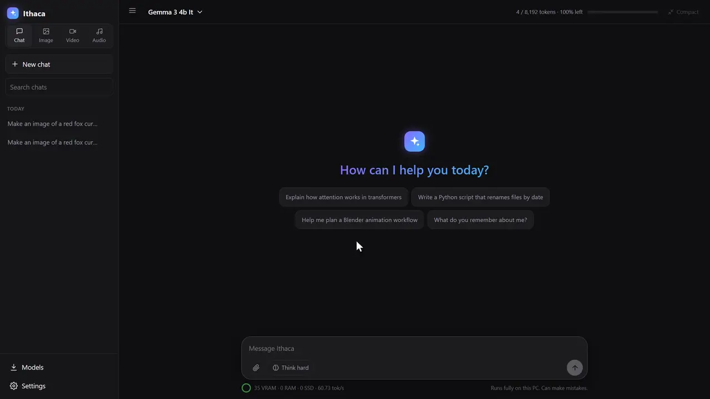
</p>

Chat with language models, show them pictures, hand them PDFs, and have them make images, video and speech. Let one work on the code and Office files in a folder, or put several on one hard question. Everything runs on your own PC, from one exe of about 3 MB.

There is no installer, no Python, no llama.cpp and no CUDA toolkit. The model loaders, tokenizers, transformer code, CPU and GPU kernels, the image, video and speech engines and the web UI are all written from scratch in C++. GPU code is generated as PTX at startup and compiled by the NVIDIA driver you already have.

## What it does

<picture>
  <source media="(prefers-color-scheme: dark)" srcset="docs/features-dark.svg">
  
</picture>

## Getting started

<picture>
  <source media="(prefers-color-scheme: dark)" srcset="docs/steps-dark.svg">
  
</picture>

1. Download an exe (see below) and put it in its own folder.
2. Double-click it. Ithaca opens in its own window, or in your browser for `Ithaca.exe`.
3. Click **Models** and download one, or point it at a folder of `.gguf` files. It also finds models from GPT4All and LM Studio on its own.
4. Load the model and start typing. You can type before it has finished loading.

**Quit** in the sidebar (or closing the window or console) stops everything and frees all memory.

### Which exe?

| | |
|---|---|
| **Ithaca App.exe** | Ithaca in its own window, with everything. No browser opens. |
| **Ithaca Chat.exe** | Its own window, chat only. |
| **Ithaca Image.exe**, **Video**, **Audio** | Its own window, just that studio. |
| **Ithaca.exe** | Opens Ithaca in your browser. Use it to reach Ithaca from other devices (`--host`) or as an API server (`--server`). |

They all share the same folder, models and data, and only one runs at a time: opening a second one adds a window to the Ithaca that is already running, so two never fight over the GPU. The app windows use WebView2, the web engine built into Windows 10 and 11, so there is nothing else to install.

The top bar shows on every page what the GPU is doing (writing a reply, making an image at 40%, loading a model) and where the model's weights are (VRAM, RAM, disk). An image, video or clip keeps rendering when you switch pages, and it's still there when you come back.

## See it work

**Chat with a PDF.** Long files are searched, and the answer points to pages.

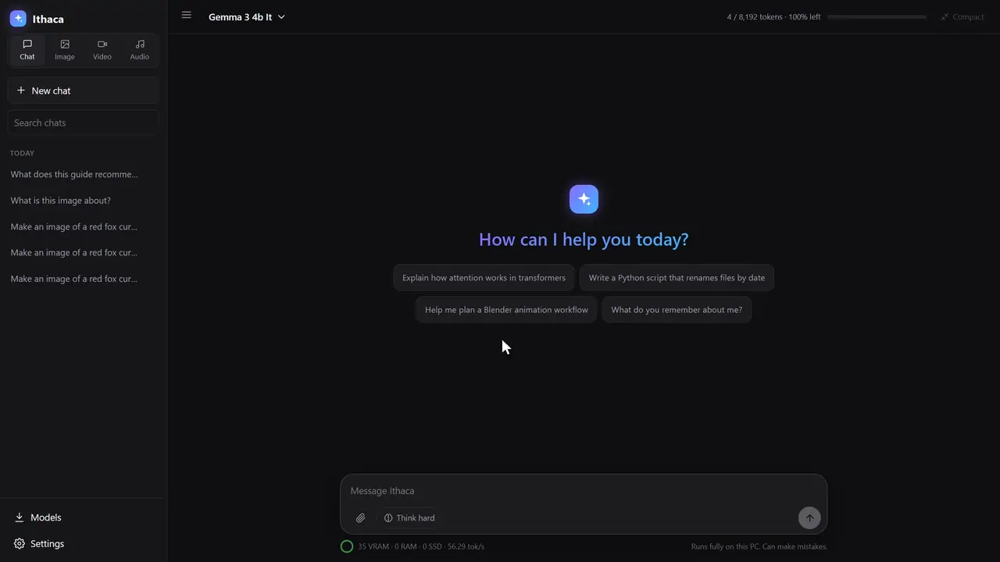

**Download models and check your PC.** Each model shows whether it fits and roughly how fast it will run.

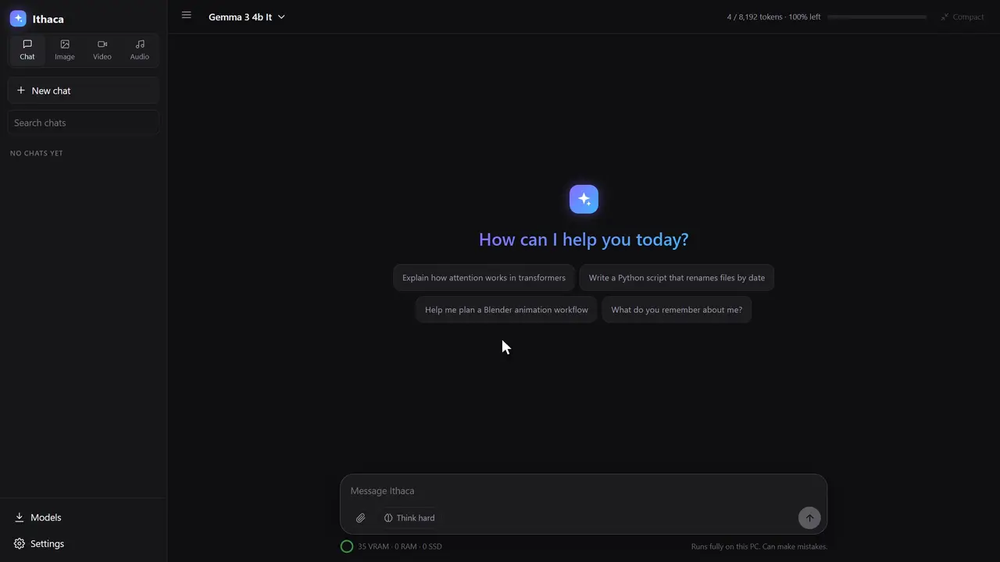

## Coding

<picture>
  <source media="(prefers-color-scheme: dark)" srcset="docs/coding-dark.svg">
  
</picture>

Open **Coding** in the sidebar, pick a folder, and ask for a change. The model works through a small set of tools, and you see each step as it happens.

- **Real files.** It lists, searches, reads, creates, edits, renames and deletes files in the folder you picked, and nowhere else.
- **Office files too.** Word, PowerPoint and Excel files are shown to the model as text with paragraph labels or cell addresses. Edits keep the formatting, and spreadsheet formulas recalculate when the file is opened.
- **You stay in charge.** Every change is shown as a diff to approve, or applied straight away if you turn on auto-apply. Commands (tests, builds) always ask first, have a time limit, and stop with **Stop** or Esc.
- **Undo.** Each change can be undone, or **Undo all** rolls back a whole task. Deleted files go to the Recycle Bin.
- **Only this PC.** The file tools answer requests from this computer only, never through `--host` or from another website.
- **Valid tool calls, even from small models.** Once the model starts a tool call, Ithaca only lets it pick tokens that keep the JSON valid. With Gemma 3 4B, broken tool calls dropped from most calls to about 1 in 27.
- **Doesn't get stuck.** When the model repeats the same step with the same result, Ithaca tells it to try something else, and stops the task if it keeps going.
- **Chats are kept per folder.** Each folder's chat is saved in full next to the exe, so it comes back when you switch folders. Delete one from the sidebar; the folder itself is never touched.
- **Long tasks fit.** When a task nears the context limit, older steps are compacted into a summary and the newest steps stay word for word. This works in Chat too, and both can be turned off under Settings → General.

Models trained for tool calls work best. Qwen3-Coder 30B-A3B runs at about 15–18 tokens a second on a 12 GB card, with the rest of the model in RAM.

**The test bench.** `eval/agent_eval.py` gives the agent 8 small tasks (fix a bug, add a feature, rename a function, edit a Word file and a spreadsheet, change a config, write a README, answer a question). Each task has a hidden check, so pass rates are measured, not guessed. You can also compare system prompts. `eval/chat_eval.py` does the same for the Chat page with 12 auto-checked questions. Running these benches is what pushed the agent from 38% to 75%: most of the gains came from fixing how Ithaca reads tool calls, not from changing the prompt.

## Orchestration

<picture>
  <source media="(prefers-color-scheme: dark)" srcset="docs/orch-dark.svg">
  
</picture>

Open **Orchestration**, tick the models you want, pick a judge, and ask. Each model works through the request on its own: it writes several answers, reviews them, and refines them over several rounds, keeping, editing, deleting or adding answers until they hold up. Then the judge compares each model's best answer.

The steps change with the kind of request. **Auto** reads the request and picks one of these:

| Method | Each model | The judge |
|---|---|---|
| Hard question | 3 answers, criticized and refined for at least 4 rounds (up to 6) | merges the strongest points |
| Code | 3 solutions; Python is run, and the output goes into the reviews; 2–4 rounds | picks the solution that works |
| Math & logic | 3 independent solutions, every step re-checked; 2–4 rounds | holds a vote on the final answers, then writes up the winner |
| Creative writing | 3 drafts in different styles, edited like an editor would; 3–4 rounds | picks the strongest piece |
| Ideas & plans | 3 plans; weak ones dropped, overlaps merged, new ones added; 3–4 rounds | combines them into one plan |
| Quick facts | one answer | writes one answer and notes where the models disagree |

You see everything: every answer with its score and whether it was kept, edited, deleted or added, every round of review, and which model the best answer came from. Runs are saved with your other data and listed in the sidebar. Models run one after another (the judge goes last, so it's still loaded). An **Effort** setting decides how much work each model does: Fast, Balanced (the default) or Thorough, each with a time limit per model and for the whole run. Two mid-size models on a hard question take about 4 minutes on Balanced.

## Privacy

Every device that opens Ithaca gets its own data: the PC itself, a second browser, the app window, a phone on your network. A device's chats, coding chats, orchestration runs, memories, settings, voices, images, videos and clips are stored on the PC running Ithaca, **encrypted with that device's own key** (AES-256-GCM, through Windows' built-in cryptography). The key lives in a cookie that the page's scripts can't read, and the PC never saves it. So one device can't open another's data, and copying the folder gives no one your chats.

- **This PC.** The window or browser that the exe opens gets the PC's own key through a one-time link. That key is protected by your Windows account (DPAPI), so your data comes back after a reboot or in another browser that Ithaca opens. Data saved by older versions moves into This PC, encrypted, the first time you start this one.
- **PIN.** Any device can add a PIN in **Settings → Privacy**. Its data then needs the PIN as well as the key. Ithaca asks for it once per browser session, and wrong guesses are slowed down.
- **Recovery code.** Shown in **Settings → Privacy**. Clearing a browser's cookies loses that browser's key; the code brings the data back, or opens the same data in another browser. Keep it private.
- **Other devices.** This PC can see how much space other devices use and delete their data, but it can't read it.

What's shared by everyone using the PC: the models, the model settings and the GPU. The API (`/v1`) doesn't belong to a device, and it keeps using the plain shared folder.

## Speed, compared with llama.cpp

<picture>
  <source media="(prefers-color-scheme: dark)" srcset="docs/bench-dark.svg">
  
</picture>

Ithaca generates at 96–104% of llama.cpp's speed and reads prompts at 85–116% of it, on the same files and the same GPU.

### Newer model families

<picture>
  <source media="(prefers-color-scheme: dark)" srcset="docs/bench-new-dark.svg">
  
</picture>

On mixture-of-experts, latent-attention and Mamba-hybrid models Ithaca generates faster than llama.cpp (101–125%); prompts are at 75–87% of it.

### Every quant type

Low-bit files fit bigger models in less VRAM. Ithaca runs all of them on the GPU at their compact size.

<picture>
  <source media="(prefers-color-scheme: dark)" srcset="docs/quants-dark.svg">
  
</picture>

## Models

**Chat (GGUF):** Llama 2/3, Mistral, Mixtral, Qwen 2/2.5/3, Qwen2-MoE (Qwen1.5-MoE), Qwen3-MoE, Qwen3.5, Phi-3/4, Granite, Granite-MoE, Granite 4.0 H, Gemma 2, Gemma 3, gpt-oss, OLMo 2, OLMoE, SmolLM3, LFM2, ERNIE 4.5, DeepSeek V2 and V2-Lite and the DeepSeek-R1 distills. Split GGUFs load from their first part.

**Quantizations:** F32, F16, BF16, Q4_0, Q4_1, Q5_0, Q5_1, Q8_0, Q2_K to Q6_K, IQ1_S to IQ4_XS, and MXFP4 (gpt-oss). Low-bit weights stay that small on the GPU.

**Pictures in:** put the model's `mmproj` file next to it (for example `gemma-3-4b-it-Q4_K_M.gguf` with `mmproj-model-f16.gguf`) and Ithaca picks it up.

| | Models | Notes |
|---|---|---|
| Images | SD 1.5, SD 2.x, SDXL single-file checkpoints and their fine-tunes; Flux.1 schnell and dev (all-in-one fp8 files) | DPM++ 2M, Euler, Euler a; optional separate VAE. Flux on a 12 GB card: about 1.5 min at 512x512, 3 to 5 min at 1024x1024 |
| Video | Wan 2.2 TI2V-5B, Wan 2.1 T2V (1.3B), Wan 2.2 T2V A14B (GGUF high/low-noise pair) | Needs the umT5 encoder and the matching Wan VAE; saves MP4. A14B on 12 GB: about 480x272, 6 to 10 min for 2 s |
| Speech | F5-TTS + Vocos | Voice cloning from a 5 to 12 second clip |

Not supported yet: DeepSeek V3/R1 (full size), Llama 4, SD3, LoRAs, image-to-video. Settings → Model shows whether each of your files is supported, and Settings → Download models gets image, video and speech models with everything they need.

## Questions

<details>
<summary><b>Why use it instead of llama.cpp, Ollama or LM Studio?</b></summary>
<br>

<picture>
  <source media="(prefers-color-scheme: dark)" srcset="docs/inside-dark.svg">
  
</picture>

- One 3 MB file: no install, no service, no runtime downloads.
- Images, video and speech out, and pictures and documents in, all in the same chat.
- Models bigger than your VRAM still run, and you can type before loading finishes.
- **Speculative decoding** is automatic: with a small model of the same family installed (Qwen3 0.6B next to Qwen3 14B), it drafts tokens for the big one. Qwen3 14B writes code at about 44 tok/s this way.
- If you need Linux, Mac or AMD support, llama.cpp is the better choice today.

</details>

<details>
<summary><b>How do models bigger than my GPU run?</b></summary>
<br>

<picture>
  <source media="(prefers-color-scheme: dark)" srcset="docs/tiers-dark.svg">
  
</picture>

- Opening a model only reads its header, so you can type right away while layers move up in the background.
- Weights reach the GPU through pinned buffers and are converted there by a kernel.
- Follow-up messages reuse the cache for the part of the chat that didn't change, and the cache is 8-bit so long chats stay small.
- When an image or video job needs the GPU, the chat model steps aside and comes back afterwards.

</details>

<details>
<summary><b>Which quant should I download?</b></summary>
<br>

<picture>
  <source media="(prefers-color-scheme: dark)" srcset="docs/quant-vram-dark.svg">
  
</picture>

Start with **Q4_K_M**. If it doesn't fit, IQ4_XS is smaller at the same speed, and the IQ3 and IQ2 files let much bigger models fit on small GPUs at some cost in quality. Every speed is in [docs/quant-speeds.md](docs/quant-speeds.md).

</details>

<details>
<summary><b>What hardware do I need?</b></summary>
<br>

<picture>
  <source media="(prefers-color-scheme: dark)" srcset="docs/hardware-dark.svg">
  
</picture>

Windows 10 or 11. The NVIDIA driver you already have is enough: no CUDA toolkit. A 4B model at 4-bit needs about 2.5 GB of VRAM; a 14B model about 8 GB.

</details>

<details>
<summary><b>How do I use it from my own code?</b></summary>
<br>

<picture>
  <source media="(prefers-color-scheme: dark)" srcset="docs/server-dark.svg">
  
</picture>

`Ithaca.exe --server --model file.gguf` starts an OpenAI-compatible API on port 8080 with no window.

| Endpoint | What it does |
|---|---|
| `GET /v1/models` | The loaded model and every GGUF Ithaca can find |
| `POST /v1/chat/completions` | Chat, streaming or not. Images as `image_url` data URLs (vision models), `stop` strings, and `"model"` switches to another local model. Reasoning models return their thinking in `reasoning_content`. |
| `POST /v1/completions` | A single prompt |
| `POST /v1/images/generations` | Images from text: `size`, `n`, `steps`, `guidance_scale`, `negative_prompt`, `seed`, `response_format` |
| `POST /v1/images/edits` | Edit a picture: `image` (base64 or multipart), optional `mask` (white = change), `strength` |
| `POST /v1/audio/speech` | Text to speech in one of your voices (returns WAV) |
| `POST /v1/videos/generations` | Text to video (Wan 2.2): `prompt`, `seconds`, `size` |
| `GET /health` | Status |

```bash
curl http://127.0.0.1:8080/v1/chat/completions -d '{"messages":[{"role":"user","content":"Hello!"}],"stream":true}'
```

```python
from openai import OpenAI
client = OpenAI(base_url="http://127.0.0.1:8080/v1", api_key="none")
print(client.chat.completions.create(model="default", messages=[{"role": "user", "content": "Hello!"}]).choices[0].message.content)
```

Options: `--port 8080`, `--host 0.0.0.0` to serve other devices on your network, and `--api-key KEY` (or the `ITHACA_API_KEY` variable) to require `Authorization: Bearer KEY`. In server mode only the API is reachable; the app's own endpoints are switched off.

`/v1/ithaca/park` and `/v1/ithaca/wake` move the chat model to RAM and back in about half a second, to free VRAM for something else. In server mode only the API is reachable.

</details>

<details>
<summary><b>How was the speed measured?</b></summary>
<br>

RTX 3060 12 GB, 16 GB RAM, the same GGUF files, all layers on the GPU, 3 runs each, the two programs run back to back per model. llama.cpp is build 11146 with CUDA, run as `llama-bench -p 512 -n 128 -ngl 99 -r 3`; Ithaca as `Ithaca.exe --bench --model file.gguf`, which runs the same test. Raw numbers: [docs/bench-results.json](docs/bench-results.json).

Prompts are read with int8 tensor cores (the same idea as llama.cpp's "mmq"), and the norm, residual add and int8 conversion around each matmul run as one fused step.

</details>

<details>
<summary><b>Command line options</b></summary>
<br>

```
Ithaca.exe [--model file.gguf] [--ctx N] [--vram MB|0] [--ram MB] [--threads N] [--port 7860] [--no-browser]
Ithaca.exe --model file.gguf --prompt "Hello" [--image photo.jpg] [-n 128]
Ithaca.exe --bench --model file.gguf
Ithaca.exe --extract report.pdf
Ithaca.exe --server [--model file.gguf] [--host 0.0.0.0] [--port 8080] [--api-key KEY]
```

</details>

<details>
<summary><b>Screenshots</b></summary>
<br>

| Asking for an image | Reading an image |
|---|---|
| 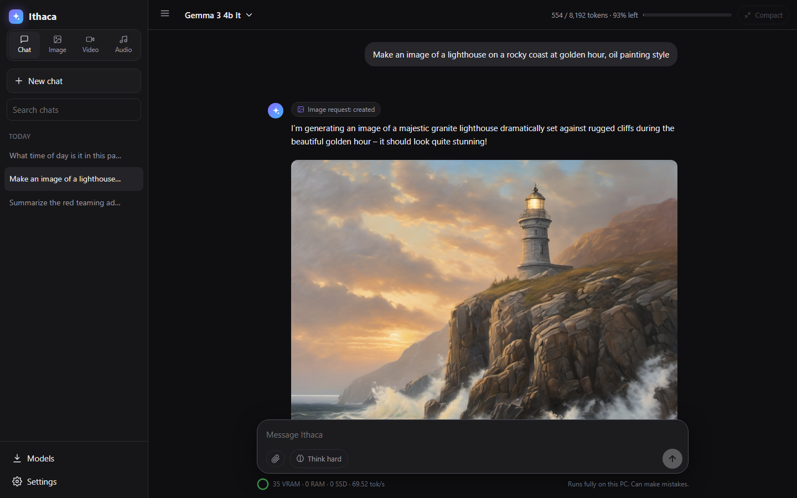 | 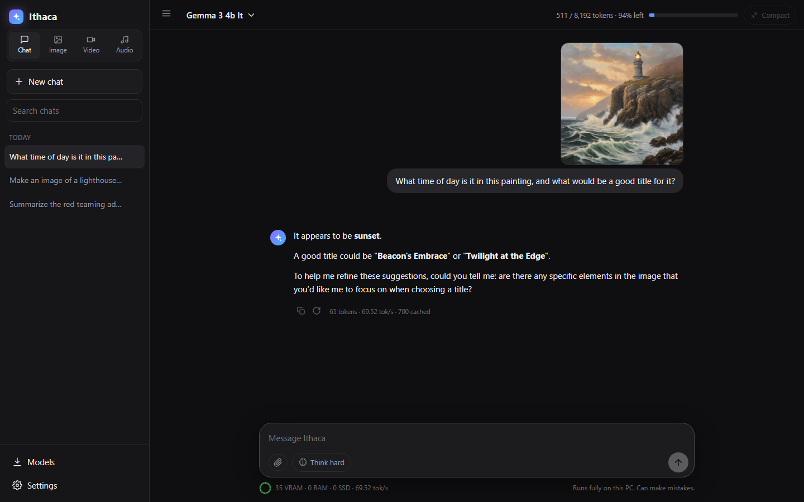 |

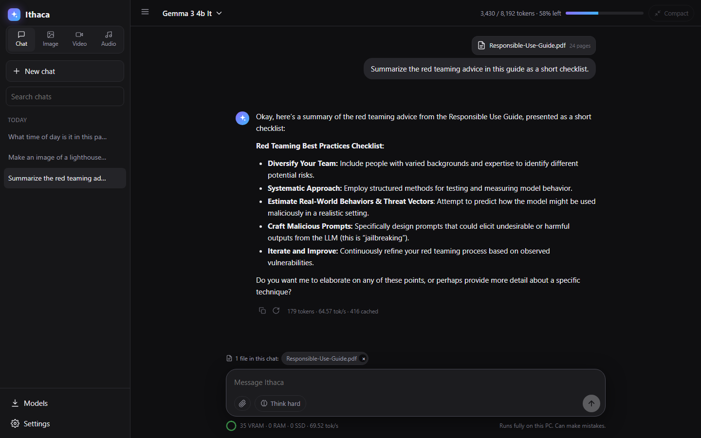

</details>

<details>
<summary><b>Building from source</b></summary>
<br>

You need MinGW-w64 g++. Run `build.bat`; the result is a single static `Ithaca.exe`. The CPU path needs AVX2.

```
src/model.*        transformer, MoE, tier planner, CPU and GPU forward passes
src/cuda_tier.*    NVIDIA driver wrapper, quantized matmul kernels, weight loader
src/gx*.cpp/h      GPU runtime for the media engines and prompt processing
src/sd.*, wan.*, tts.*   image, video and speech engines
src/vision.*       image input (SigLIP encoder for Gemma 3)
src/docs.cpp       PDF / DOCX / PPTX / XLSX text extraction
src/chat.*         chat templates, sampling, prompt cache
src/hub.cpp        model downloads, system info, benchmark
src/main.cpp       HTTP server and CLI;  src/ui.cpp  the web UI
```

</details>

## Roadmap

- Close the rest of the prompt-speed gap on Gemma 3 and mixture-of-experts models.
- Faster gpt-oss prompts; DeepSeek V3 routing.
- SD3, LoRAs, image-to-video; faster Flux and Wan 14B on 12 GB cards.
- AMD and Intel GPUs (Vulkan).
- Orchestration: run small models at the same time when they fit in VRAM together.

## License

Apache 2.0. See [LICENSE](LICENSE).
