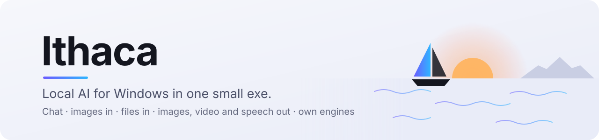
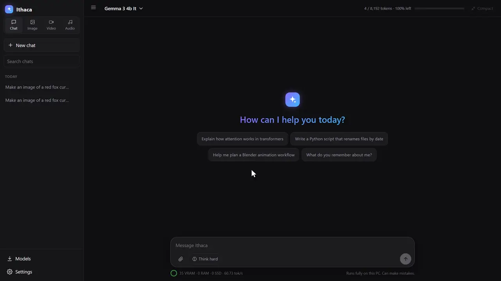
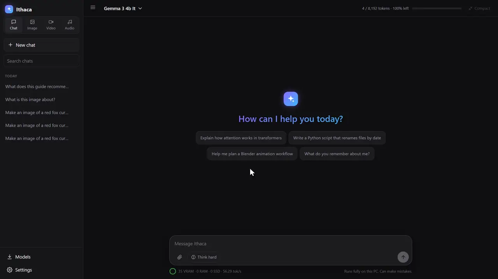
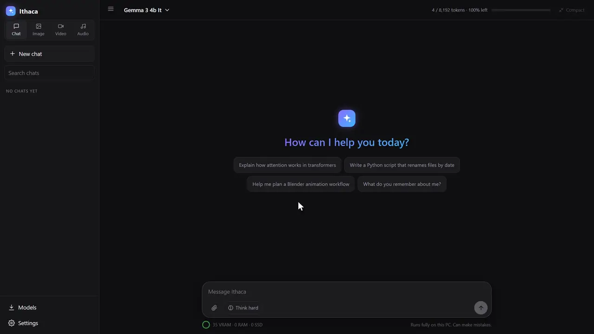
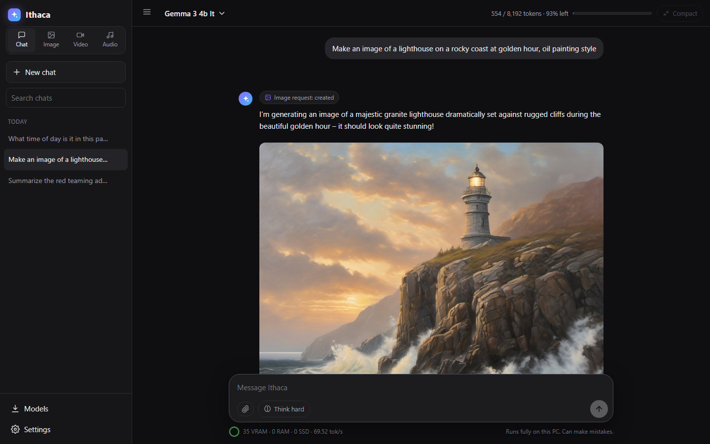
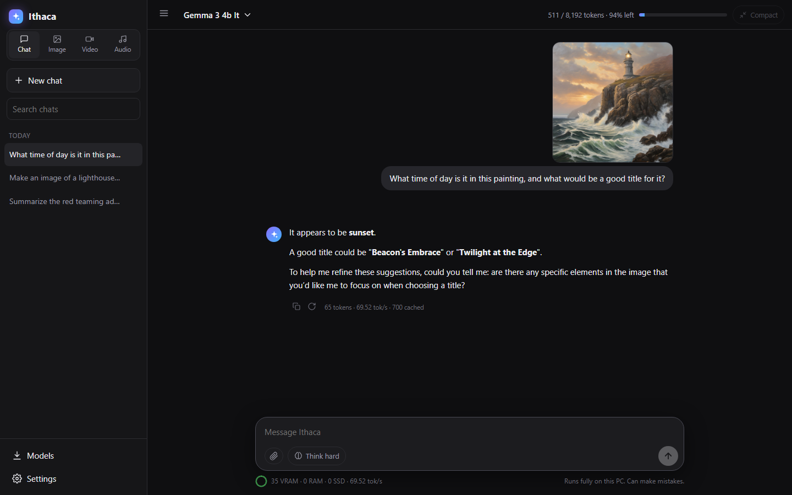
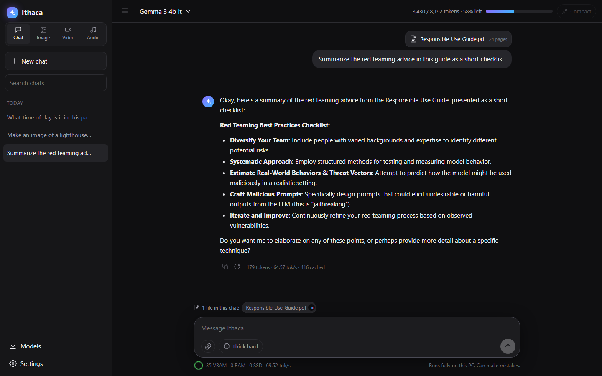
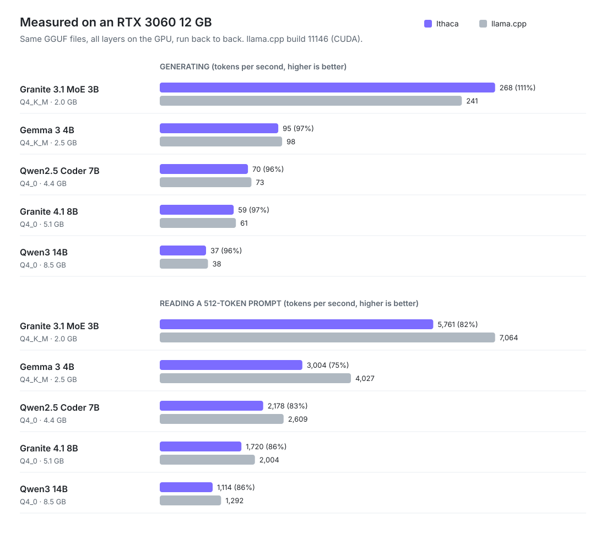

<picture>
  <source media="(prefers-color-scheme: dark)" srcset="docs/banner-dark.svg">
  
</picture>

<p align="center">
  <a href="https://github.com/SwankyMan88/ithaca/releases/latest"></a>
  <a href="LICENSE"></a>
  
  
  
</p>

<p align="center">
  <b><a href="https://github.com/SwankyMan88/ithaca/releases/latest">Download Ithaca.exe</a></b> · double-click it · pick a model · chat
</p>

<p align="center">
  
</p>

Chat with language models, show them pictures, hand them PDFs, and have them make images, video and speech. Everything runs on your own PC, from one exe of about 2 MB.

There is no installer, no Python, no llama.cpp and no CUDA toolkit. The model loaders, tokenizers, transformer code, CPU and GPU kernels, the image, video and speech engines and the web UI are all written from scratch in C++. GPU code is generated as PTX at startup and compiled by the NVIDIA driver you already have.

## What it does

- **Chat** with GGUF models. Chats are saved, messages can be edited or regenerated, and there is a "Think hard" mode that reasons over a question in several passes before answering.
- **Runs models bigger than your VRAM.** Layers that don't fit on the GPU go to RAM, and what doesn't fit there streams from the SSD. You can start chatting immediately while layers move up in the background.
- **Reads images.** Paste or drop a picture into the chat (needs a vision model like Gemma 3).
- **Reads files.** PDF, Word, PowerPoint, Excel, text and code. Short files go in whole; long ones are searched so the model gets the relevant passages and cites the page.
- **Makes images, video and speech** from a normal chat message, with a live preview while the image renders. Click an image to view it full size, or use the buttons on it to copy or save it.
- **Remembers you.** A long-term memory the model can save to, search, edit and delete, which you can manage in Settings.
- **Downloads models** from GPT4All's list or any Hugging Face GGUF repo, and benchmarks your PC so it can tell you how fast each model will run.

## More demos

**Chat with a PDF.** Attach a file and ask about it. Long files are searched, and the answer points to pages.



**Download models and check your PC.** Each model shows whether it fits in VRAM and roughly how fast it will run. The system page lists your hardware.



## Screenshots

| Asking for an image | Reading an image |
|---|---|
|  |  |



## Getting started

1. Download `Ithaca.exe` (or build it, see below) and put it in its own folder.
2. Double-click it. A console window opens and the chat page opens in your browser.
3. Click **Models** in the sidebar and download one, or point it at a folder of `.gguf` files you already have. It also finds models from GPT4All and LM Studio on its own.
4. Load the model and start typing.

Settings, chats and memories are kept next to the exe, so the folder is portable. To stop Ithaca, use **Quit** in the sidebar or close its console window; nothing keeps running and all memory is freed. Starting it again while it runs just opens the existing window.

## Models

Chat models (GGUF): Llama 2/3, Mistral, Mixtral, Qwen 2/2.5/3, Qwen3-MoE, Phi-3/4, Granite, Granite-MoE, Gemma 3 and the DeepSeek-R1 distills.

Quantizations: F32, F16, BF16, Q4_0, Q4_1, Q5_0, Q5_1, Q8_0, Q4_K, Q5_K and Q6_K. 4-bit weights stay 4-bit on the GPU.

For image input, put the model's `mmproj` file next to it (for example `gemma-3-4b-it-Q4_K_M.gguf` with `mmproj-model-f16.gguf`). Ithaca picks it up automatically.

Media engines:

| | Models | Notes |
|---|---|---|
| Images | SD 1.5, SD 2.x, SDXL single-file checkpoints and their fine-tunes | DPM++ 2M, Euler, Euler a; optional separate VAE |
| Video | Wan 2.2 TI2V-5B | Needs the umT5 encoder and the Wan 2.2 VAE; saves MP4 |
| Speech | F5-TTS + Vocos | Voice cloning from a 5 to 12 second clip |

Not supported yet: Mamba hybrids (Granite 4.0 H), Qwen2-MoE, IQ and Q2/Q3_K quants, split GGUFs, Flux/SD3, LoRAs, image-to-video.

## Speed, compared with llama.cpp

<picture>
  <source media="(prefers-color-scheme: dark)" srcset="docs/bench-dark.svg">
  
</picture>

Ithaca generates at 76–90% of llama.cpp's speed with its own kernels. Reading long prompts is where llama.cpp is still clearly ahead (3–8×); faster prompt kernels are the next thing on the list.

| Model | Generation (Ithaca / llama.cpp) | Prompt, 512 tokens (Ithaca / llama.cpp) |
|---|---|---|
| Granite 3.1 MoE 3B Q4_K_M | 201 / 223 tok/s | 819 / 6,584 tok/s |
| Gemma 3 4B Q4_K_M | 70 / 92 tok/s | 1,178 / 3,717 tok/s |
| Qwen2.5 Coder 7B Q4_0 | 56 / 68 tok/s | 673 / 2,398 tok/s |
| Granite 4.1 8B Q4_0 | 46 / 57 tok/s | 547 / 1,661 tok/s |
| Qwen3 14B Q4_0 | 30 / 35 tok/s | 301 / 1,019 tok/s |
| Qwen3 14B Q4_0, code, with Qwen3 0.6B as draft | 44 tok/s | |

Method: RTX 3060 12 GB, 16 GB RAM, same GGUF files, all layers on the GPU, average of 3 runs. llama.cpp is build 11146 with CUDA, run as `llama-bench -p 512 -n 128 -ngl 99 -r 3`; Ithaca as `Ithaca.exe --bench --model file.gguf`, which runs the same test. Raw numbers are in [docs/bench-results.json](docs/bench-results.json). Time from start to first token was about even (faster on some models, slower on others).

### Why use it over llama.cpp, Ollama or LM Studio?

- One 2 MB file, no install, no runtime downloads. LM Studio is several hundred MB; Ollama installs a service.
- Images, video and speech out, and images and documents in, in the same app and the same chat.
- Runs models larger than your VRAM by streaming from RAM and SSD, and you can type before the model has finished loading.
- If you want the fastest raw throughput or Linux/Mac/AMD support, llama.cpp is the better choice today.

- **Speculative decoding:** if a small model with the same vocabulary is installed (for example Qwen3 0.6B next to Qwen3 14B), Ithaca uses it automatically to draft tokens that the main model checks. It mostly helps code and structured text, pauses itself when it doesn't help, and only runs when there is spare VRAM. It can be turned off in Settings → Model & hardware.
- **Long chats stay fast:** the conversation cache is stored as 8-bit in VRAM and only grows as the chat does.
- Loading an 8B model onto the GPU takes about 1.5 s once the file is in the OS cache.
- Reading an image takes about 0.7 s.
- A 1024 px SDXL image at 20 steps takes about a minute.

## How the memory tiers work

| Tier | What goes there |
|---|---|
| VRAM | The output head and as many layers as fit. A whole layer runs on the GPU, and token generation replays a CUDA graph. |
| RAM | The next layers, locked in memory so Windows doesn't page them out. |
| SSD | Everything else, memory-mapped and read ahead while the current layer computes. |

A few details:

- Opening a model only reads its header, so you can type right away. The weights reach the GPU through pinned buffers and are converted to the GPU format by a kernel, not on the CPU.
- Follow-up messages reuse the KV cache for the part of the conversation that didn't change.
- By default about 768 MB of VRAM and 2.5 GB of RAM are left free for other programs. Both limits can be set in Settings.
- When an image or video job needs the GPU, the chat model steps aside and reloads afterwards.

## Command line

```
Ithaca.exe [--model file.gguf] [--ctx N] [--vram MB|0] [--ram MB] [--threads N] [--port 7860] [--no-browser]
Ithaca.exe --model file.gguf --prompt "Hello" [--image photo.jpg] [-n 128]
Ithaca.exe --bench --model file.gguf
Ithaca.exe --extract report.pdf
```

## Roadmap

- Faster prompt processing (int8 tensor-core kernels).
- More architectures: Mamba hybrids, Qwen2-MoE, IQ quants, split GGUFs.
- Flux and SD3 image models, LoRAs, image-to-video.

## Building

You need MinGW-w64 g++. Run `build.bat`; the result is a single static `Ithaca.exe`.

- The CPU path needs AVX2.
- The GPU path needs an NVIDIA driver and a GTX 10-series or newer card. Tensor-core features need an RTX 30-series or newer.
- On any other hardware Ithaca runs on the CPU.

```
src/model.*        transformer, MoE, tier planner, CPU and GPU forward passes
src/cuda_tier.*    NVIDIA driver wrapper, quantized matmul kernels, weight loader
src/gx*.cpp/h      GPU runtime for the media engines and prompt processing
src/sd.*, wan.*, tts.*   image, video and speech engines
src/vision.*       image input (SigLIP encoder for Gemma 3)
src/docs.cpp       PDF / DOCX / PPTX / XLSX text extraction
src/chat.*         chat templates, sampling, prompt cache
src/hub.cpp        model downloads, system info, benchmark
src/main.cpp       HTTP server and CLI;  src/ui.cpp  the web UI
```

## License

Apache 2.0. See [LICENSE](LICENSE).
