<picture>
  <source media="(prefers-color-scheme: dark)" srcset="docs/banner-dark.svg">
  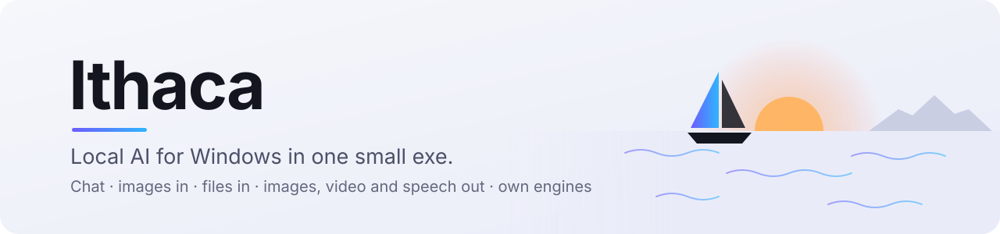
</picture>

<p align="center">
  <a href="https://github.com/SwankyMan88/ithaca/releases/latest"></a>
  <a href="LICENSE"></a>
  
  
  
</p>

<p align="center">
  <b><a href="https://github.com/SwankyMan88/ithaca/releases/latest">Download Ithaca.exe</a></b> · double-click it · pick a model · chat
</p>

<p align="center">
  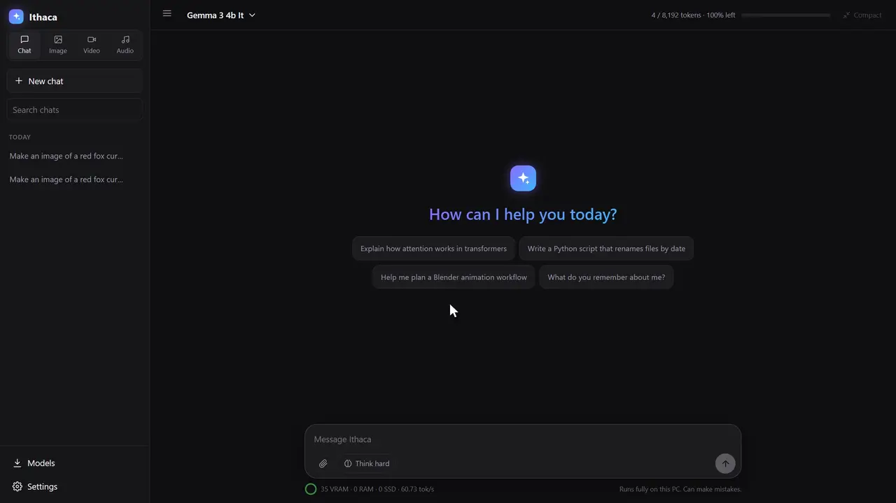
</p>

Chat with language models, show them pictures, hand them PDFs, and have them make images, video and speech. Everything runs on your own PC, from one exe of about 2 MB.

There is no installer, no Python, no llama.cpp and no CUDA toolkit. The model loaders, tokenizers, transformer code, CPU and GPU kernels, the image, video and speech engines and the web UI are all written from scratch in C++. GPU code is generated as PTX at startup and compiled by the NVIDIA driver you already have.

## What it does

<picture>
  <source media="(prefers-color-scheme: dark)" srcset="docs/features-dark.svg">
  
</picture>

## Getting started

<picture>
  <source media="(prefers-color-scheme: dark)" srcset="docs/steps-dark.svg">
  
</picture>

1. Download `Ithaca.exe` and put it in its own folder.
2. Double-click it. A console window opens and the chat page opens in your browser.
3. Click **Models** and download one, or point it at a folder of `.gguf` files. It also finds models from GPT4All and LM Studio on its own.
4. Load the model and start typing. You can type before it has finished loading.

Settings, chats and memories are kept next to the exe, so the folder is portable. **Quit** in the sidebar (or closing the console) stops everything and frees all memory.

## See it work

**Chat with a PDF.** Long files are searched, and the answer points to pages.

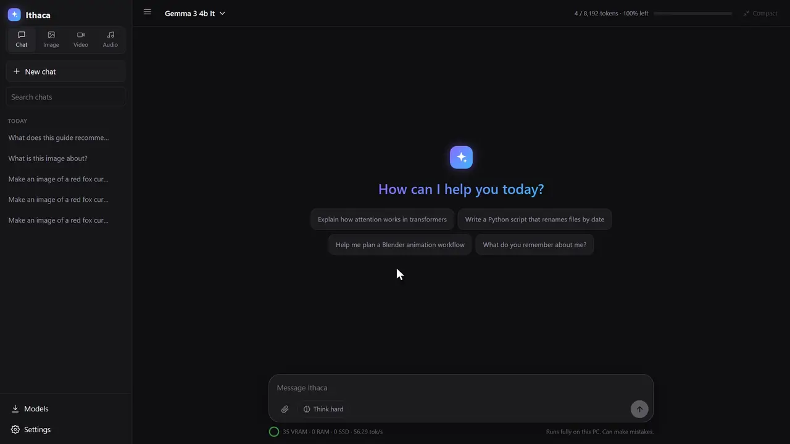

**Download models and check your PC.** Each model shows whether it fits and roughly how fast it will run.

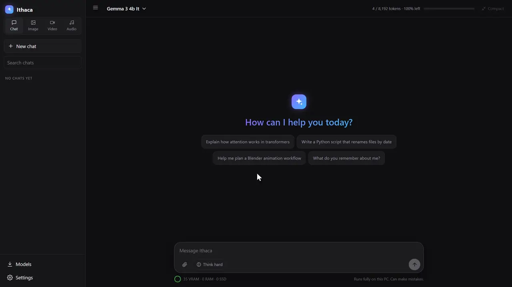

## Speed, compared with llama.cpp

<picture>
  <source media="(prefers-color-scheme: dark)" srcset="docs/bench-dark.svg">
  
</picture>

Ithaca generates at 96–104% of llama.cpp's speed and reads prompts at 85–116% of it, on the same files and the same GPU.

### Every quant type

Low-bit files fit bigger models in less VRAM. Ithaca runs all of them on the GPU at their compact size.

<picture>
  <source media="(prefers-color-scheme: dark)" srcset="docs/quants-dark.svg">
  
</picture>

## Models

**Chat (GGUF):** Llama 2/3, Mistral, Mixtral, Qwen 2/2.5/3, Qwen3-MoE, Phi-3/4, Granite, Granite-MoE, Gemma 3, gpt-oss and the DeepSeek-R1 distills.

**Quantizations:** F32, F16, BF16, Q4_0, Q4_1, Q5_0, Q5_1, Q8_0, Q2_K to Q6_K, IQ1_S to IQ4_XS, and MXFP4 (gpt-oss). Low-bit weights stay that small on the GPU.

**Pictures in:** put the model's `mmproj` file next to it (for example `gemma-3-4b-it-Q4_K_M.gguf` with `mmproj-model-f16.gguf`) and Ithaca picks it up.

| | Models | Notes |
|---|---|---|
| Images | SD 1.5, SD 2.x, SDXL single-file checkpoints and their fine-tunes | DPM++ 2M, Euler, Euler a; optional separate VAE |
| Video | Wan 2.2 TI2V-5B | Needs the umT5 encoder and the Wan 2.2 VAE; saves MP4 |
| Speech | F5-TTS + Vocos | Voice cloning from a 5 to 12 second clip |

Not supported yet: Mamba hybrids (Granite 4.0 H), Qwen2-MoE, split GGUFs, Flux/SD3, LoRAs, image-to-video.

## Questions

<details>
<summary><b>Why use it instead of llama.cpp, Ollama or LM Studio?</b></summary>
<br>

<picture>
  <source media="(prefers-color-scheme: dark)" srcset="docs/inside-dark.svg">
  
</picture>

- One 2 MB file: no install, no service, no runtime downloads.
- Images, video and speech out, and pictures and documents in, all in the same chat.
- Models bigger than your VRAM still run, and you can type before loading finishes.
- **Speculative decoding** is automatic: with a small model of the same family installed (Qwen3 0.6B next to Qwen3 14B), it drafts tokens for the big one. Qwen3 14B writes code at about 44 tok/s this way.
- If you need Linux, Mac or AMD support, llama.cpp is the better choice today.

</details>

<details>
<summary><b>How do models bigger than my GPU run?</b></summary>
<br>

<picture>
  <source media="(prefers-color-scheme: dark)" srcset="docs/tiers-dark.svg">
  
</picture>

- Opening a model only reads its header, so you can type right away while layers move up in the background.
- Weights reach the GPU through pinned buffers and are converted there by a kernel.
- Follow-up messages reuse the cache for the part of the chat that didn't change, and the cache is 8-bit so long chats stay small.
- When an image or video job needs the GPU, the chat model steps aside and comes back afterwards.

</details>

<details>
<summary><b>Which quant should I download?</b></summary>
<br>

<picture>
  <source media="(prefers-color-scheme: dark)" srcset="docs/quant-vram-dark.svg">
  
</picture>

Start with **Q4_K_M**. If it doesn't fit, IQ4_XS is smaller at the same speed, and the IQ3 and IQ2 files let much bigger models fit on small GPUs at some cost in quality. Every speed is in [docs/quant-speeds.md](docs/quant-speeds.md).

</details>

<details>
<summary><b>What hardware do I need?</b></summary>
<br>

<picture>
  <source media="(prefers-color-scheme: dark)" srcset="docs/hardware-dark.svg">
  
</picture>

Windows 10 or 11. The NVIDIA driver you already have is enough: no CUDA toolkit. A 4B model at 4-bit needs about 2.5 GB of VRAM; a 14B model about 8 GB.

</details>

<details>
<summary><b>How do I use it from my own code?</b></summary>
<br>

<picture>
  <source media="(prefers-color-scheme: dark)" srcset="docs/server-dark.svg">
  
</picture>

`Ithaca.exe --server --model file.gguf` starts an OpenAI-compatible API on port 8080 with no window.

| Endpoint | What it does |
|---|---|
| `GET /v1/models` | The loaded model and every GGUF Ithaca can find |
| `POST /v1/chat/completions` | Chat, streaming or not. Images as `image_url` data URLs (vision models), `stop` strings, and `"model"` switches to another local model. Reasoning models return their thinking in `reasoning_content`. |
| `POST /v1/completions` | A single prompt |
| `POST /v1/images/generations` | Images from text: `size`, `n`, `steps`, `guidance_scale`, `negative_prompt`, `seed`, `response_format` |
| `POST /v1/images/edits` | Edit a picture: `image` (base64 or multipart), optional `mask` (white = change), `strength` |
| `POST /v1/audio/speech` | Text to speech in one of your voices (returns WAV) |
| `POST /v1/videos/generations` | Text to video (Wan 2.2): `prompt`, `seconds`, `size` |
| `GET /health` | Status |

```bash
curl http://127.0.0.1:8080/v1/chat/completions -d '{"messages":[{"role":"user","content":"Hello!"}],"stream":true}'
```

```python
from openai import OpenAI
client = OpenAI(base_url="http://127.0.0.1:8080/v1", api_key="none")
print(client.chat.completions.create(model="default", messages=[{"role": "user", "content": "Hello!"}]).choices[0].message.content)
```

Options: `--port 8080`, `--host 0.0.0.0` to serve other devices on your network, and `--api-key KEY` (or the `ITHACA_API_KEY` variable) to require `Authorization: Bearer KEY`. In server mode only the API is reachable; the app's own endpoints are switched off.

`/v1/ithaca/park` and `/v1/ithaca/wake` move the chat model to RAM and back in about half a second, to free VRAM for something else. In server mode only the API is reachable.

</details>

<details>
<summary><b>How was the speed measured?</b></summary>
<br>

RTX 3060 12 GB, 16 GB RAM, the same GGUF files, all layers on the GPU, 3 runs each, the two programs run back to back per model. llama.cpp is build 11146 with CUDA, run as `llama-bench -p 512 -n 128 -ngl 99 -r 3`; Ithaca as `Ithaca.exe --bench --model file.gguf`, which runs the same test. Raw numbers: [docs/bench-results.json](docs/bench-results.json).

Prompts are read with int8 tensor cores (the same idea as llama.cpp's "mmq"), and the norm, residual add and int8 conversion around each matmul run as one fused step.

</details>

<details>
<summary><b>Command line options</b></summary>
<br>

```
Ithaca.exe [--model file.gguf] [--ctx N] [--vram MB|0] [--ram MB] [--threads N] [--port 7860] [--no-browser]
Ithaca.exe --model file.gguf --prompt "Hello" [--image photo.jpg] [-n 128]
Ithaca.exe --bench --model file.gguf
Ithaca.exe --extract report.pdf
Ithaca.exe --server [--model file.gguf] [--host 0.0.0.0] [--port 8080] [--api-key KEY]
```

</details>

<details>
<summary><b>Screenshots</b></summary>
<br>

| Asking for an image | Reading an image |
|---|---|
| 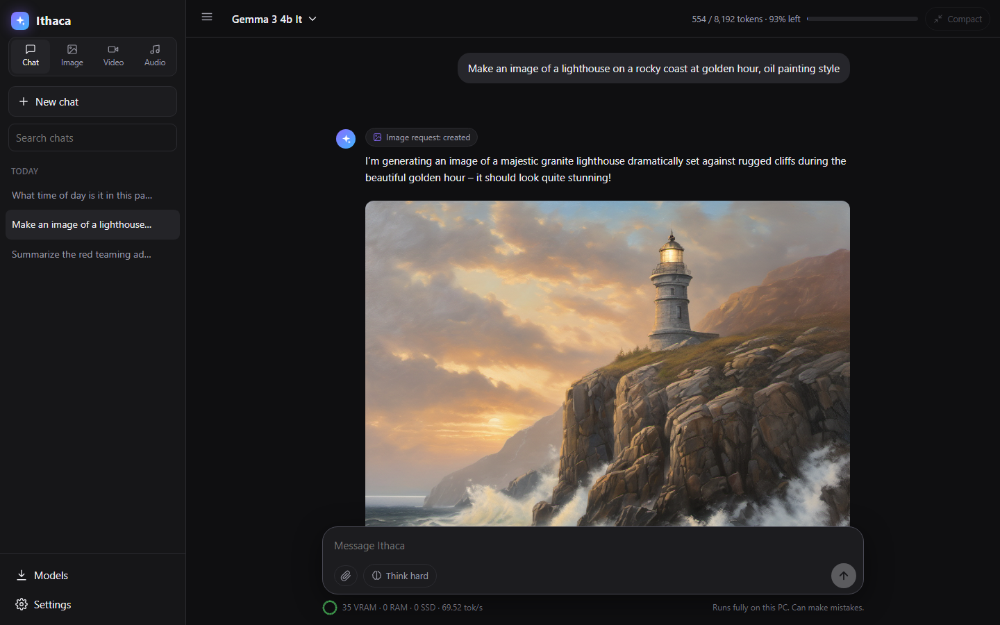 | 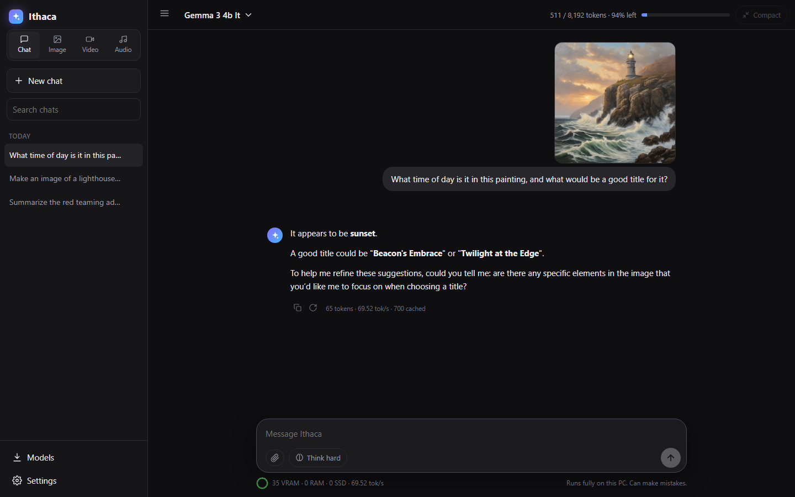 |

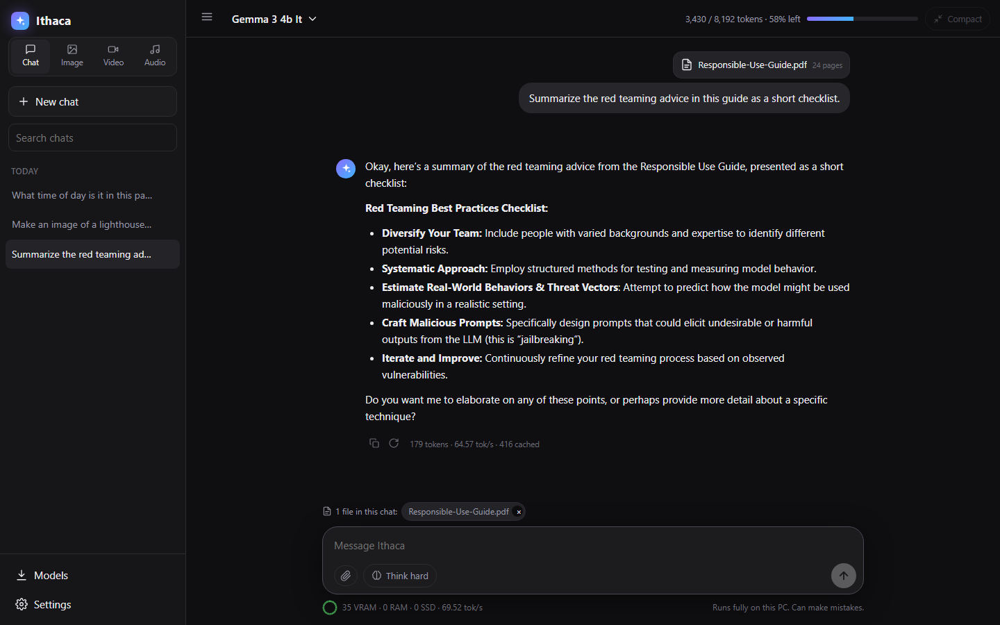

</details>

<details>
<summary><b>Building from source</b></summary>
<br>

You need MinGW-w64 g++. Run `build.bat`; the result is a single static `Ithaca.exe`. The CPU path needs AVX2.

```
src/model.*        transformer, MoE, tier planner, CPU and GPU forward passes
src/cuda_tier.*    NVIDIA driver wrapper, quantized matmul kernels, weight loader
src/gx*.cpp/h      GPU runtime for the media engines and prompt processing
src/sd.*, wan.*, tts.*   image, video and speech engines
src/vision.*       image input (SigLIP encoder for Gemma 3)
src/docs.cpp       PDF / DOCX / PPTX / XLSX text extraction
src/chat.*         chat templates, sampling, prompt cache
src/hub.cpp        model downloads, system info, benchmark
src/main.cpp       HTTP server and CLI;  src/ui.cpp  the web UI
```

</details>

## Roadmap

- Close the rest of the prompt-speed gap on Gemma 3 and mixture-of-experts models.
- Faster gpt-oss prompts, Mamba hybrids, Qwen2-MoE, split GGUFs.
- Flux and SD3 image models, LoRAs, image-to-video.
- AMD and Intel GPUs (Vulkan).

## License

Apache 2.0. See [LICENSE](LICENSE).
